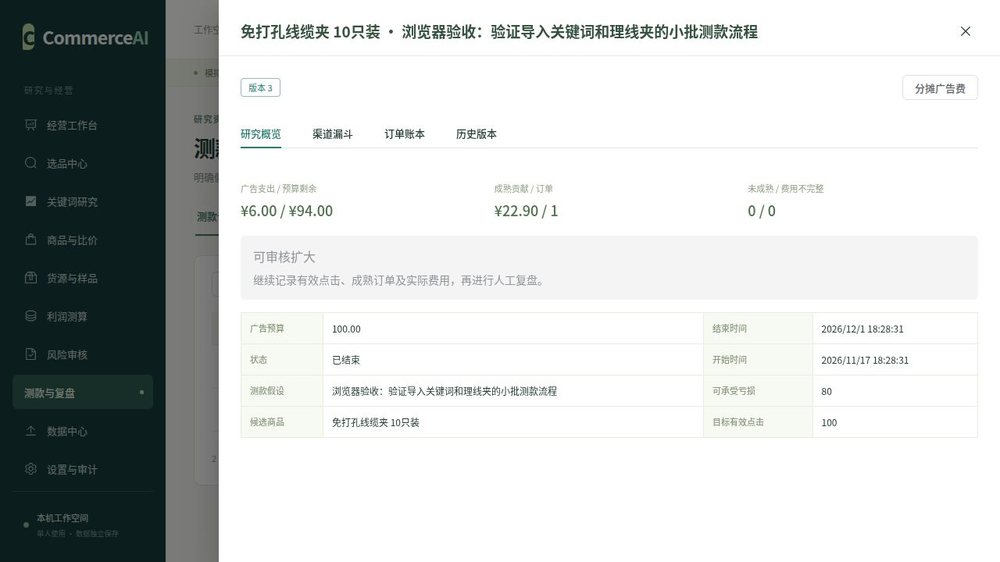

# CommerceAI

[](https://github.com/tellmai/CommerceAI/actions/workflows/ci.yaml)

本地电商选品与经营研究工作台。围绕关键词、同规格比价、供应链、贡献利润和测款复盘保存证据与历史版本。

首版为单人使用的完整 P0：Vue 3 中文界面、FastAPI、PostgreSQL 16 和单并发后台任务。规则负责计算，用户负责研究及审核；P0 不调用付费 AI 模型。



## 快速启动

当前电脑已经准备了原生运行环境，可以打开 **http://127.0.0.1:8000**。本机访问口令保存在 `.local/admin-password`，该文件和 `.env` 都不会提交 Git。

### Docker Compose

```bash
python3 scripts/setup.py
bash scripts/start.sh
# http://127.0.0.1:8080
bash scripts/stop.sh
```

未安装 Docker 时，可由本机管理员运行 `sudo bash scripts/install-docker.sh`。脚本使用 Docker 官方 Ubuntu 软件源，不修改用户组权限。此电脑当前没有免密管理员权限，因此系统 Docker 尚未安装；已采用原生 PostgreSQL 路径完成实际开发和验收。Compose 配置及安装脚本已提供，容器启动需安装后验证。

### 无 Docker 的本机模式

需要 Python 3.12、Node.js 22 或更高版本。首次安装：

```bash
COMMERCEAI_PYTHON=python3.12 bash scripts/bootstrap-native.sh
```

此电脑已有隔离环境，后续直接运行：

```bash
.venv/bin/python scripts/native.py start
.venv/bin/python scripts/native.py stop
```

原生模式使用项目内的 PostgreSQL 16 二进制和私有 Unix socket，不创建系统数据库服务。数据库、日志、上传文件及凭据保存在 `.local/`。停止服务不会删除数据。

## 开始研究

1. 在“模拟演示”查看候选、同款价格、样品、风险及测款示例。
2. 在“数据中心”登记数据来源，选择 CSV/XLSX、工作表及字段映射，先预览再确认导入。
3. 建立商品和标准 SKU，登记平台商品、确认同款、录入主备供货报价。
4. 保存正常及压力利润情景，补充研究评估、样品和风险审核，再人工推进候选阶段。
5. 创建测款计划，录入渠道漏斗、订单及退款，按已成熟且费用完整的订单复盘。

演示、公开历史、真实经营三个空间独立。来源停用、授权过期、证据修改、样品失败、规格冲突或报价失效都会影响当前审核；高分不能覆盖阻断。买样前可以保留样品未知，进入测款必须完成必要核验。

## 真实公开数据

采用 [UCI Online Retail](https://archive.ics.uci.edu/dataset/352/online+retail)，作者 Daqing Chen，2015，DOI [10.24432/C5BW33](https://doi.org/10.24432/C5BW33)，许可 [CC BY 4.0](https://creativecommons.org/licenses/by/4.0/)。

当前已导入 5,000 行官方历史样本：数量合计 45,929，金额合计 **GBP 102,189.24**，72 条取消记录保持未匹配。数据来自 2010–2011 年的英国零售交易，不包含采购、广告等完整成本，不能用于判断当前淘宝行情或计算完整经营利润。客户标识未保留。

```bash
.venv/bin/python scripts/fetch_public_data.py --limit 5000
# 需设置 DATABASE_URL，原生连接写法见 docs/运行与维护.md
.venv/bin/python scripts/import_public_data.py
# 全量准备：--limit 0，默认每5万行拆为一个导入批次
```

来源、原文件 SHA256、处理控制总量和许可见 [公开数据清单](data/public_manifest.json)。全量原文件和生成的批次不进入 Git；CI 使用有出处的小型真实样本。

## 验证与资源

```bash
cd backend
../.venv/bin/ruff check .
TEST_DATABASE_URL='postgresql+psycopg://commerceai@/commerceai_test?host=/绝对路径/CommerceAI/.local/pgsocket&port=55432' ../.venv/bin/python -m pytest -q
cd ../frontend
npm ci
npm run types
npm run build
```

测试只能指向名称以 `_test` 结尾的独立数据库，不能使用工作台数据库。详细命令、浏览器验收和备份恢复见 [验收报告](docs/验收报告.md) 及 [运行与维护](docs/运行与维护.md)。

10万行实测导入约 **83秒**，分页 P95 约 **63毫秒**，API、worker 与 PostgreSQL 合计 PSS 峰值约 **316MiB**。这是原生模式实测，不含浏览器、构建和操作系统文件缓存。Compose 的四个容器内存上限合计 2,176MiB；日常前端使用静态文件，不常驻 Node 开发服务。原始测量数据见 [benchmark.json](docs/benchmark.json)。

## 文档

- [修订设计与文档入口](docs/README.md)
- [工程实施规格](docs/02_Codex工程实施规格_V1.1.md)
- [运营 SOP 与任务状态](docs/03_运营SOP与开发任务_V1.1.md)
- [API 契约](docs/openapi.yaml)、[数据库结构](docs/schema.sql)、[字段字典](docs/字段字典.md)
- [公开数据说明](docs/公开数据与许可.md)、[设计决策](docs/ADR.md)

`file/` 保留原始 V1.0 交付包，修订内容以 `docs/` 为准。敏感凭据、数据库文件、原始大数据、构建产物和内部 QA 文件均被 Git 忽略。
