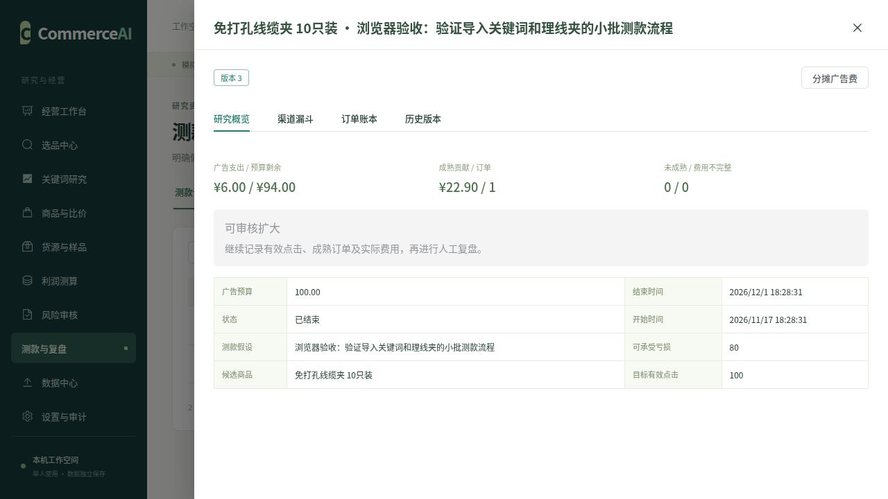

# P0 验收报告

本机验收日期：2026-11-17；仓库交付和远程 CI 核验：2026-11-18。范围为用户确认的完整 P0，设计修订 V1.1。当前电脑以原生 PostgreSQL 16.2、单进程 API、单并发 worker 和编译后 Vue 静态界面运行；本机地址为 http://127.0.0.1:8000。

## 验证结果

| 验证项 | 实际结果 | 证据 |
|---|---|---|
| 后端自动回归 | 42 项通过；1 条 Starlette/httpx 弃用提示，不影响通过 | `backend/tests/`，独立 `_test` 数据库 |
| 静态检查及前端 | Ruff、TypeScript、Vite 生产构建通过 | 锁定依赖；OpenAPI 生成类型 |
| 契约与迁移 | 全新 PostgreSQL 执行 Alembic 到 head 通过；生成契约无漂移 | `docs/openapi.yaml`、`schema.sql`、字段字典 |
| 利润与规则 | 原始六组利润、零收入/零运费、退款率 0/1、负贡献、舍入、未知、平值百分位、缺失权重及等级顺序通过 | `test_domain.py` |
| 导入与任务 | 预览不写正式记录；部分成功、重复、公式/文件限制、空间隔离、检查点、重试及租约隔离通过 | `test_api.py`、`test_workflows.py` |
| 审核流程 | 规格冲突不能确认、报价/证据失效重核、失败样品阻断、并发审批仅一项成功、原评分重放通过 | `test_workflows.py` |
| 实际账本 | 部分及全额退款、未知费用、成熟结算、支付日渠道分摊及尾差通过 | `test_domain.py`、端到端业务测试 |
| 公开历史 | 官方样本 5000 行与独立控制总量一致 | 清单及下节 |
| 浏览器流程 | 导入到测款复盘完成；保存审核与历史版本，成熟贡献 22.90 元 | 下节、界面截图 |
| GitHub Docker 验收 | 四服务构建启动、静态页面、健康检查、口令登录、备份及独立恢复通过 | [CI 运行](https://github.com/tellmai/CommerceAI/actions/runs/44220265618) 的 compose 任务 |
| 数据库备份恢复 | 恢复至独立新库、摘要及计数一致、13 个证据文件可用、会话为 0 | `restore-check.json` |
| Word 与 Excel | Word 渲染逐页复核；工作簿重算、8 项关键自检及公式错误扫描通过 | V1.1 交付文件 |

测试不写入真实经营空间。CI 定义还包括独立数据库、浏览器测试、四容器构建启动及独立备份恢复；实际远程运行状态以仓库 Actions 为准。

## 浏览器实际演练

使用模拟演示空间，通过界面上传包含两行的 CSV，确认字段映射后得到成功 1 行、失败 1 行，并显示错误报告下载入口。成功关键词“浏览器验收理线夹”关联到“免打孔线缆夹 10只装”。重新评分显示增长因子未知、覆盖率 90%，没有伪造完整总分。

逐级保存买样、样品、测款准备审核，建立预算 100 元、止损 80 元的计划并启动。录入 1000 曝光、120 有效点击、1 支付订单、6 元广告费；模拟订单实付 49.9，采购 15、运费 4、包材 1、净费用 1、其余确认零，广告先留空，成熟和结算状态由人工确认。

广告分摊后，成熟贡献 **22.90 元**，剩余预算 **94 元**，费用不完整记录为 0；人工保存“建议扩大”审核，实验结束。此过程为模拟验收，不是实际投放或盈利证明。

## 公开历史与独立核对

UCI Online Retail 原始 ZIP SHA256：`f5385cbb54bbebf7196389109c6b0621faab0c304e3702548165e71c84aede8b`。官方历史文件的前 5000 行预处理后，数量合计 **45929**，交易金额合计 **GBP 102189.2400**，取消记录 **72** 条，均保持未匹配。保留原币种、历史日期和来源时区；没有采购、运费及广告数据，贡献为未知。

CI 的真实小样为 15 行，包含取消记录；数量合计 82、金额 GBP 188.65、取消 3 条。控制文件、来源和 CC BY 4.0 署名在 `backend/tests/fixtures/`。公开批量数据与国内模拟研究互不混用。

## 性能和资源

环境：Ubuntu 22.04、Intel i7-14700、约 31GiB 物理内存。使用隔离测试库和单并发导入；分页在导入期间抽样。内存为 PSS，覆盖 API、worker 和整个 PostgreSQL 实例，排除浏览器、构建及操作系统文件缓存。

| 指标 | 实测 | 初始目标 |
|---|---:|---:|
| 导入行数 | 100000，成功 100000，失败 0 | 100000 |
| 输入文件大小 | 4592056 字节 | 默认不超过 20MB |
| 总导入时间 | 83.365 秒 | 小于 600 秒 |
| 分页 P95 | 62.787 毫秒，34 次样本 | 小于 1000 毫秒 |
| 分页中位 | 10.424 毫秒 | — |
| 空闲 API / worker / PostgreSQL | 64.55 / 41.44 / 58.66MiB | — |
| 常规浏览器操作合计 PSS 峰值 | 144.06MiB，30 秒、140 次采样 | — |
| 导入时合计 PSS 峰值 | 316.34MiB | — |

原始测量见 [benchmark.json](benchmark.json) 和 [常规操作内存](normal-memory.json)。常规中文页面、列表、筛选、导入和测款写入已在浏览器验证；上述内存为可重复压测进程测量，不是整个桌面或所有未来数据量的内存上限。

## 当前环境限制

当前电脑没有 Docker，也没有免密管理员权限，系统级安装需要管理员执行 `sudo bash scripts/install-docker.sh`。因此本机容器运行和容器内存峰值尚未实测；原生运行不受 Compose 的容器硬限制。Compose 已配置数据库 768MiB、API 512MiB、worker 768MiB、前端 128MiB，合计 2176MiB，默认仅监听本机。CI 中的容器验收与当前电脑原生实测分别记录。

真实淘宝接口、当前平台行情、真实供应链及经营效果需要后续授权数据和实际订单。AI 报告、平台 API、监控、多店铺未冒充 P0 已实现功能。当前版本为单用户本地研究应用，跨网络部署需另行设计访问范围、HTTPS 和用户权限。
